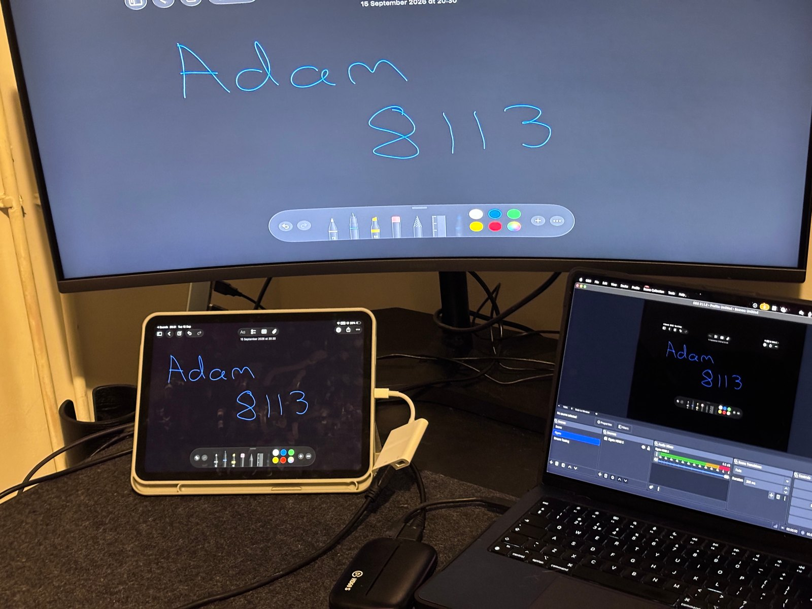

I have an Elgato HD60 S and it's not supported on Apple Silicon. I was annoyed
I had this card sat around that I can't use, so I made a native Apple
Silicon driver for it. It took weeks and it is fully working. I have recorded
via OBS for several hours without a frame dropping. It was far too complicated
and I hated it by the end.

If it's solved a problem for you and you want to, you can buy me a coffee
[here](https://buymeacoffee.com/adam8113).

For transparency I used AI for the trace analysis. Without it I don't think I'd have cracked it on my own.

## What you get

A user-space driver plus an OBS plugin that adds the card as a source with video and audio in one.

1080p60 and 720p60 both capture. The HDMI passthrough keeps working throughout.

## Build

    brew install simde
    make
    git clone --depth 1 -b 31.1.2 https://github.com/obsproject/obs-studio
    make obs-plugin OBS_SRC=obs-studio

Clone the tag matching the OBS you run. OBS bakes the API version of these
headers into the plugin and refuses to load one built against a different
major version. `OBS_APP` defaults to `/Applications/OBS.app`, pass it if yours
is elsewhere.

The plugin installs to `~/Library/Application Support/obs-studio/plugins`.
Restart OBS and add the source "Elgato HD60 S". The source
starts the capture itself, cold init included, and stops it again when you
remove the source. It takes about seven seconds to show a picture. If the picture stays black, read `/tmp/hd60s-capture.log`.

If the picture is green where it should be dark grey and pink where it should
be white, your source is sending RGB rather than YCbCr. A Nintendo Switch always
does. Open the source's properties and set "Input colour" to RGB. That option is
a correction fitted from one capture, so colours are close but not exact yet.

To drive it by hand, untick "Start the capture with this source" and run:

    ./start replay data/cold-init-replay.txt
    ./hd60s-obs

`hd60s-obs --udp` skips the plugin and sends mpegts to udp://127.0.0.1:9600 for
an OBS media source instead.

## How it works

The card arrives dormant and needs a long init before it will send anything.
`data/cold-init-replay.txt` is that init, replayed reads and all. The MCU's I2C proxy is driven by polling a status port,
so a write-only replay of the same sequence leaves the passthrough dead. That took me down a rabbit hole for several days.

After that it streams on endpoint 0x83, alt 2, at about 259 MB/s.
Every line is 3840 bytes of YUY2 followed by a trailer:

    ff 00  [ ff 02 <8 bytes audio> ff 00 ]  00 tt

`tt` is 0x80 on an active line and 0xab on a vertical blanking line, so the
trailer gives you the frame boundary too: 1080 active lines then 45 blanking.
The middle block is optional. It turns up on about one line in three and carries
two stereo samples as four little-endian int16 in L R L R order. 400 blocks per
frame at 60 fps is 48000 Hz.

Three processes, joined by a fifo and a unix socket:

    start   IOKit, isochronous reads, raw bytes out
    demux   parses the above, emits YUY2 frames and s16le PCM
    plugin  obs_source_output_video and _audio, in OBS

Timestamps come from counting frames and samples rather than from arrival time.
Both streams come off the same pixel clock at exactly 800 samples per frame, so
counting keeps them locked to each other.

## The board

| Part | Role |
|------|------|
| Cypress CYUSB3014 (EZ-USB FX3) | USB 3.0 peripheral, host link |
| Nuvoton M031LD2AE (Cortex-M0) | MCU, video input and LEDs, two I2C buses |
| MST3367 / ITE IT6802E | video front end, HDMI receiver |
| ITE IT66121FN | HDMI transmitter, passthrough |
| Altera MAX II CPLD | video stream formatting |
| Winbond W25Q32 | FX3 and MCU firmware |

USB IDs `0fd9:004f`, `0fd9:005e` and `0fd9:0074` are the same device. There is
no hardware encoder on the board.

## License

MIT, see `LICENSE`.